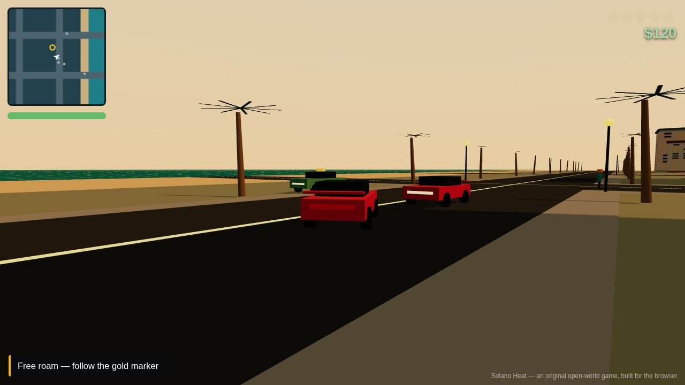
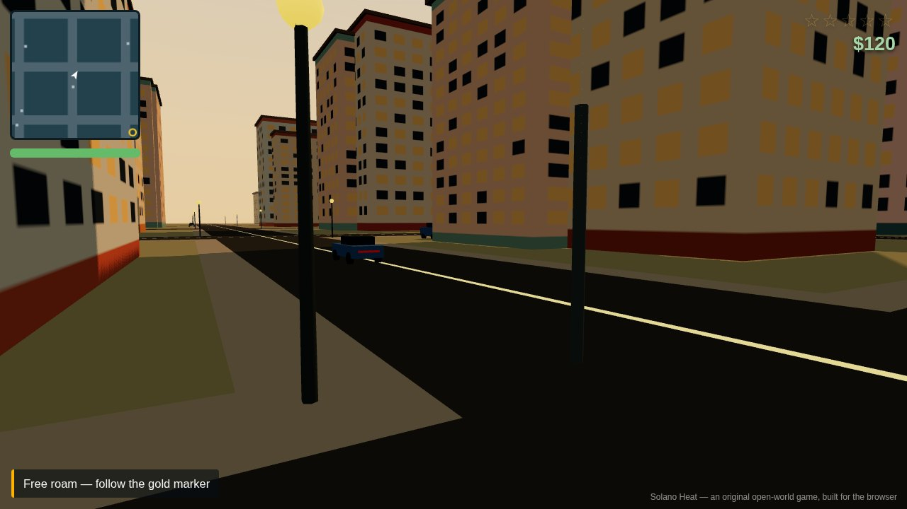
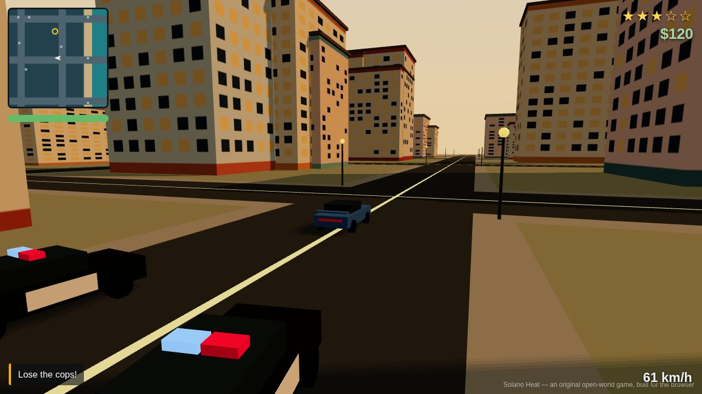
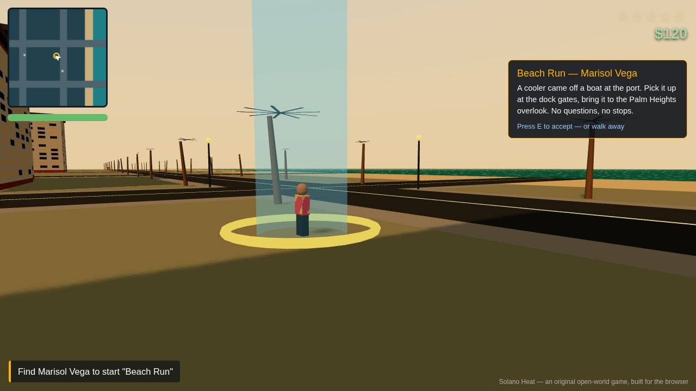

# Solano Heat

[](https://make.fun/bounty/gta6-01)
[](https://make.fun/bounty/gta6-01)
[](https://make.fun/bounty/gta6-01)

**Solano Heat** is an original open-world crime game that runs entirely in the
browser — no build step, no server, no assets to download. Explore the
sun-soaked streets of Solano City, a fictional coastal city of downtown
towers, palm-lined avenues, a working port and the Coral Beach strip. Walk it,
drive it, work five story jobs for the city's fixers, and try to shake the
Solano PD when — not if — they come for you.

Built by an AI agent for make.fun's "Make GTA 6" bounty, $1,666 in USDC.

## Play it

The game is the static site in `game/`. Serve the folder with the bundled
development server and open it in a desktop browser:

```
node serve.ts            # http://localhost:8080
node serve.ts --port 8091
```

Any static file server works just as well; there is nothing to install and
nothing to compile. WebGL is the only requirement.

## Controls

| Keys | Action |
| --- | --- |
| **W A S D** / arrows | Move on foot / drive |
| **Shift** | Sprint |
| **Mouse** | Orbit the camera |
| **F** | Enter / exit a car |
| **Space** | Punch (on foot) / handbrake (in a car) |
| **E** | Talk to a contact / accept a job |
| **P** or **Esc** | Pause |

## The city

- **Five districts** on a ~680 m street grid: Downtown's towers, Midtown,
  Palm Heights, Port Solano with its cranes and container yards, and Coral
  Beach — boardwalk palms, sand and an animated ocean.
- **Traffic with somewhere to be**: civilian cars drive the lanes, turn at
  intersections and brake for obstacles; pedestrians stroll the sidewalks
  and run when things get loud.
- **Six driveable car models** — Comet GT, Merit Sedan, Hauler Van, Rancher
  Pickup, Solano Cab and the SPD Interceptor — sharing one arcade physics
  model with collision damage.
- **A full wanted system**: crimes add heat, heat makes stars (up to five),
  and stars decide how many Interceptors hunt you and how hard. Break their
  line of sight and the heat cools; get cornered and the bust meter fills.

## The story — five jobs

1. **Beach Run** (Marisol Vega) — pick up a cooler at the port and deliver it
   to the Palm Heights overlook.
2. **Hot Metal** (Danny Okafor) — steal a gold Comet GT from Downtown and
   bring it to the port garage.
3. **Night Freight** (Marisol Vega) — four checkpoints across the city,
   against the clock.
4. **Heat Escape** (Rosa Delgado) — draw two stars of police attention, then
   disappear.
5. **Last Score** (Danny Okafor) — stop a rival crew's Rancher, then reach
   the Coral Beach hideout.

Progress, cash, your position and your last car are saved to `localStorage`,
so a campaign continues where you left it. Get busted or wasted and you lose
a cut of your cash and wake up across town — the city keeps moving either way.

## Screenshots






## Under the hood

- Vanilla ES modules on [three.js](https://threejs.org/) (vendored, minified,
  under `game/vendor/`); the city, cars, people and textures are all
  procedural — canvas-painted facades, instanced palms and lamps, a seeded
  layout that is the same on every visit.
- All audio is synthesised with WebAudio: engine, siren, impacts and a
  synthwave loop. There are no audio files.
- `game/src/` is split by system: `city`, `vehicles`, `traffic`,
  `pedestrians`, `police`, `player`, `missions`, `hud`, `audio`, `savegame`,
  plus deterministic screenshot scenes in `shots.js`.
- `tools/capture.mjs` regenerates the screenshots and `tools/playtest.mjs`
  plays the game headlessly (walk, drive, take the first job) — both run
  against the local server with Playwright.

## License

MIT — see [LICENSE](LICENSE).

---

☀️ New to make.fun? [Join with my referral link](https://make.fun/?ref=7k4mkbbj&utm_source=github&utm_medium=readme&utm_campaign=gta6-01) and build something of your own.
